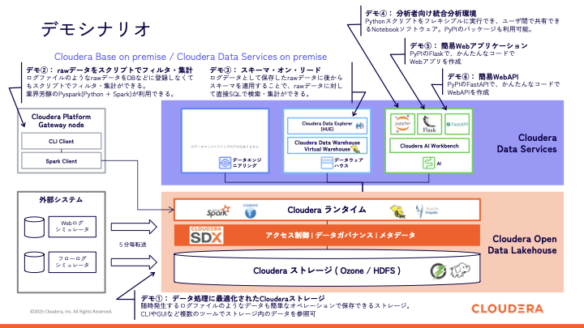
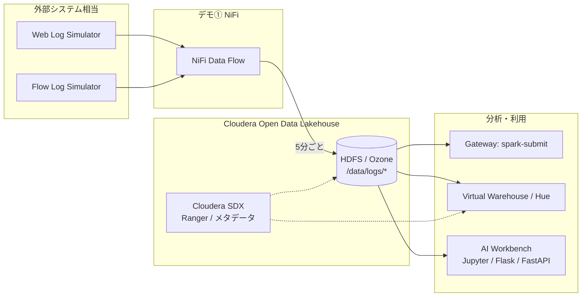

# Cloudera Platform デモプロジェクト

Cloudera Base（オンプレミス）と Cloudera Data Services（オンプレミス）上でのデータ利活用の一連の流れを体験するためのデモ資産です。

外部システム（Web アクセスログ・VPC Flow Log のシミュレータ）からデータレイクへ取り込み、**生ログのまま** Spark / Hive / Jupyter / Web アプリで検索・集計・可視化します。ETL で別系統に複製せず、**スキーマオンリード**で分析する構成がデモの中心です。

## このリポジトリでできること

| デモ | 概要 | フォルダ |
|------|------|----------|
| **①** | ログを HDFS（Ozone/HDFS）に継続取り込み | [`nifi/`](nifi/) |
| **②** | PySpark で raw ログをフィルタ・集計（DB 登録不要） | [`spark/`](spark/) |
| **③** | Hive 外部テーブル + SQL（スキーマオンリード） | [`hive/`](hive/) |
| **④** | JupyterLab で対話的分析（表・グラフ） | [`jupyterlab/`](jupyterlab/) |
| **⑤** | Flask 簡易 Web アプリ（ログ閲覧・フィルタ） | [`flask/`](flask/) |
| **⑥** | FastAPI 簡易 Web API（集計 JSON） | [`fastapi/`](fastapi/) |

詳細な手順と話法は次のドキュメントを参照してください。

- [デモ環境の構成と前提条件](docs/demo-environment.md)
- [デモシナリオ（①〜⑥）実施ガイド](docs/demo-scenarios.md)



## アーキテクチャ（データの流れ）



- **入力ログ**: Apache httpd *combined* 形式、AWS VPC Flow Log **v2** 形式
- **HDFS パス**: `/data/logs/httpd` , `/data/logs/flowlog`
- **Hive**: データベース `demo_logs`、外部テーブル `weblog` / `flowlog`

## ディレクトリ構成

```
demo_project/
├── nifi/           # デモ① NiFi フロー定義・生成スクリプト
├── spark/          # デモ② PySpark（01〜07 + 共通 httpd_logs.py）
├── hive/           # デモ③ HiveQL（DDL + サンプルクエリ + Ranger メモ）
├── jupyterlab/     # デモ④ Notebook（httpd_log_analysis.ipynb）
├── flask/          # デモ⑤ Workbench Application（Flask）
├── fastapi/        # デモ⑥ Workbench Application（FastAPI）
├── data/           # ローカル検証用サンプルログ
└── docs/           # デモ環境・シナリオ説明
```

## クイックスタート（ローカル確認）

Cloudera クラスタがなくても、**サンプルログ**で Spark スクリプトの動作確認ができます。

```bash
cd spark
spark-submit 01_overview.py --local
# または Python のみ（PySpark 環境が必要）
python3 01_overview.py --local
```

Hive / Flask / FastAPI / Jupyter は **Kerberos 認証済みの CDP 環境**（Hue、Gateway、AI Workbench）を前提としています。

## 免責

本プロジェクトは PoC / デモ用途のサンプルコードです。ログ等の実データの取り扱いは組織のポリシーに従ってください。
